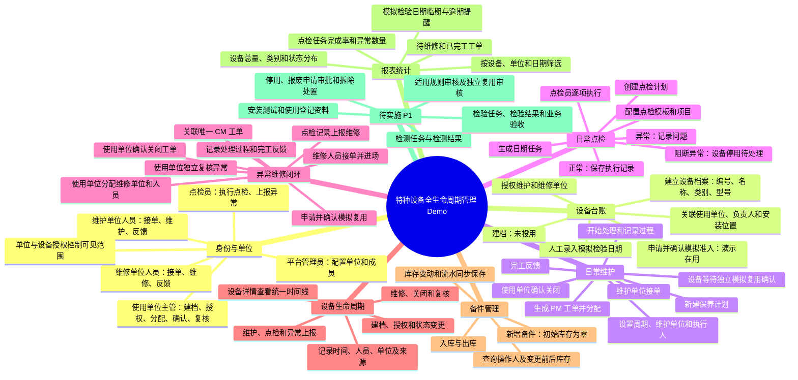

# 特种设备全生命周期管理 Demo：工作流程思维导图

依据本工作树的 P0 交付说明和实际演示脚本整理。以下为虚构业务演示；模拟准入和检验日期不构成法定检验证明或许可。P1 功能尚未实施。

## P0 核心操作顺序

设备建档 → 模拟准入 → 日常维护与点检 → 异常上报 → 维修单位接单与完工 → 使用单位确认关闭 → 异常独立复核 → 模拟复用 → 查看生命周期与报表。

- 点检、检测、检验和业务验收属于不同业务；P0 的日常点检不代表法定检验。
- 维修完工或工单关闭不会自动代表设备获准恢复使用；阻断异常需先复核，再按演示流程确认模拟复用。
- 七个现有菜单：工作台、设备台账、工单管理、保养计划、点检记录、备件管理、报表统计。

详细操作位置见 [demo-script.md](demo-script.md)，已知限制见 [known-issues.md](known-issues.md)。
