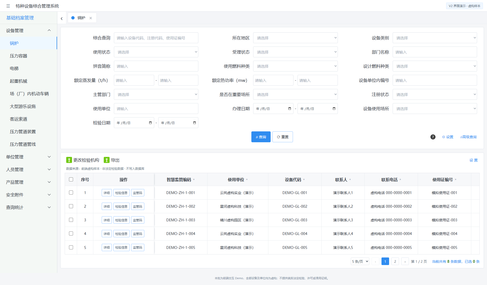
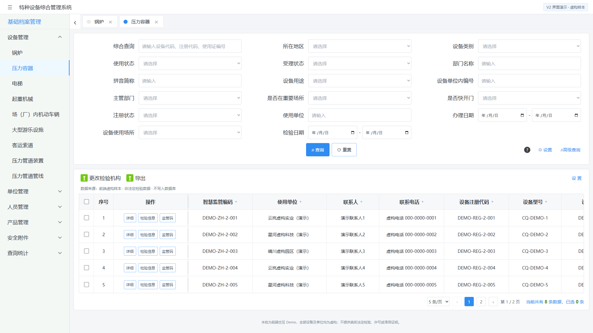
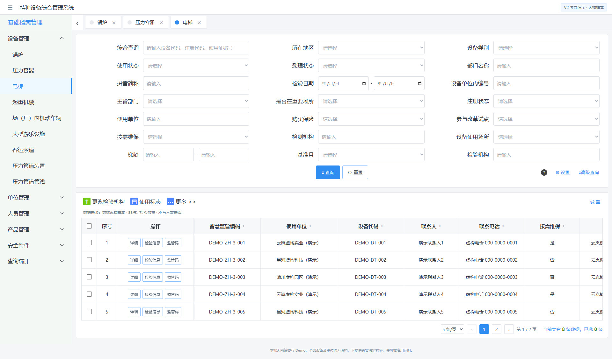
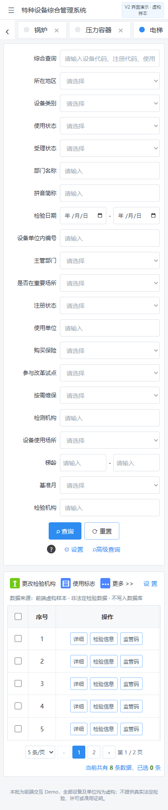

# 三类页面参考与实际截图

原图完整文件均保留于 ../references/special-equipment-ui/，不是缩略图字段清单。
主要视觉差异详见 verification.md。

## 锅炉

[参考原图08](C:/Users/willi/.codex/reference-archives/special-equipment-v2/2026-10-29-offwork/08-codex-clipboard-dd98c572-3fff-4946-8702-2ba1a73a32de.png)

## 压力容器

[参考原图09](C:/Users/willi/.codex/reference-archives/special-equipment-v2/2026-10-29-offwork/09-codex-clipboard-9c8ce990-de37-4637-93f0-2e36444c0283.png)

## 电梯

[参考原图10](C:/Users/willi/.codex/reference-archives/special-equipment-v2/2026-10-29-offwork/10-codex-clipboard-d750a360-d5c5-42df-9e53-c95f5fc7a8f5.png)

## 窄屏

