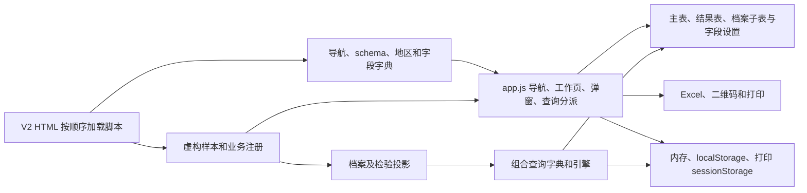

# OpenCMMS V2 架构评估

基线 6a1d4a3，2026-11-12。范围为 21 个业务入口。未发现 V2 的 GLOSSARY.md 或 ADR，沿用业务代码中的术语。以模块接口的深度、修改的局部性和对调用方的杠杆评估候选工作。

## 当前结构与依赖

1. [HTML 入口](../static/v2.html#L9)按顺序加载普通 JavaScript，各模块通过 window 暴露能力。配置及 fixtures 先加载，档案、单位和人员随后，最后由 app 接线。这样可以不使用打包器。调用方需要了解注册顺序和共享对象的引用；单位恢复在人员生成之前，这已产生跨模块身份缺陷。[导航与类型](../static/v2/config.js#L524)声明设备字段、表头和操作，单位、人员、产品、安全阀脚本注册或扩展类型。三类组合查询单独走[页面分派](../static/v2/app.js#L303)。
2. [设备 schema](../static/v2/config.js#L544)定义字段、控件、选项和匹配规则。七类共享主页面，管道装置和管线使用专用 schema；产品、单位、人员和附件各保留业务规则。地区级联与[产品类别](../static/v2/product-categories.js)有实际复用。同名字段不必共享定义，例如产品类别与在用设备类别，以及年度检验、全面检验和在线检验。
3. [档案模块](../static/v2/dossier.js#L187)承担表单、历史和当前值投影、管线关联、子表和弹出菜单。[组合查询字典](../static/v2/query-dictionaries.js#L38)复用档案字段，并实现人、单位、设备三种实际 adapter；[引擎](../static/v2/query-engine.js)集中类型运算、同记录条件和结果投影。档案复用减少重复定义，但查询层也因而依赖同时包含 DOM 逻辑的模块。
4. [表格设置](../static/v2/query-results.js#L5)统一列顺序、显隐、颜色、冻结和存储。主表、组合结果和档案子表仍分别维护分页、筛选和选择。弹窗以[共享 dialog](../static/v2/app.js#L236)为入口，检验、资质和设置有子 dialog。产品弹出菜单等用 AbortController 清理局部监听。[产品菜单](../static/v2/boiler-product.js#L138)
5. [通用 Excel 导入](../static/v2/excel-import.js)管理解析、预览和写入，人员及产品提供专用 schema；安全阀仍有独立解析路径。[XLSX 导出](../static/v2/query-results.js#L61)集中日期、数字和文本转换，导出范围及顺序由调用方决定。组合查询保留 CSV。设备二维码使用本地库，电梯使用标志通过新窗口和 sessionStorage 传递短期数据。[打印入口](../static/v2/elevator-tools.js#L29)
6. 默认设备数据、产品副本和一部分更正存于内存；单位、人员导入、产品导入及编辑、安全阀、方案和部分显示设置各有带版本的 localStorage 键。人员、产品和安全阀使用浏览器锁；单位和方案有独立读改写过程。没有 V2 IndexedDB 业务库或跨设备同步。存储生命周期及每模块能力见[功能盘点](v2-feature-inventory.md)。

## 构建与部署

[本地预览](../v2_server.py#L14)只监听本机 8020、校验 Host、放行指定资源和打印别名，并设置 CSP。启动需要 Django 配置、依赖和本地快照文件，[V2 URL 配置](../cmms_project/v2_urls.py#L1)为空。文件存在检查与浏览器是否读写数据库是两个不同环节。[Pages 构建](../scripts/build_v2_pages.py#L20)从允许列表和许可证生成静态树、重写入口和资源路径并验证清单与字节。静态部署没有本地服务器设置的 HTTP 响应头。

[GitHub Actions](../.github/workflows/v2-pages.yml#L19)在 Ubuntu 使用 Python 3.12、Node 22 构建、验证公开文件并执行 V2 单测，再用固定 Playwright/Chromium 跑 Pages E2E。成功后才上传部署。测试覆盖根路径、项目子路径、全部菜单、17 类 XLSX 和部分主要交互。其余专项浏览器脚本在工作流之外。构建校验不包含业务权限、真实模板隐私和恶意输入行为测试。

## 深化候选

| 顺序和建议力度 | 当前问题 | 前后对照与验证收益 |
| --- | --- | --- |
| 1 **强**，稳定记录身份及共享投影 | [人员](../static/v2/personnel.js#L10)用可变单位数组下标生成 ID；[设备批量更改](../static/v2/app.js#L160)直接改行，[档案](../static/v2/dossier.js#L187)、[查询](../static/v2/query-dictionaries.js#L44)和[管线汇总](../static/v2/app.js#L426)分别处理当前、历史及关联值。 | 当前是页面和字典共享可变行；候选是集中稳定 ID、关系缺失语义、当前/历史投影。先修人员与单位关联，再以装置/管线读链路验证。删除测试显示档案字段复用值得保留，删除会把投影逻辑分散到更多调用方。以同一接口测试删除后身份、历史不变、跨类型隔离和在用管线范围。 |
| 2 **强**，组合查询方案生命周期 | [方案列表](../static/v2/query-plans.js#L11)的渲染闭包承担存储、字段别名、AST 改写和失败保留；[部分字段 ID](../static/v2/dossier.js#L371)源于展示分组。 | 当前改显示结构可能影响已存方案；候选是稳定语义 ID 和集中版本迁移，继续保留 UI 与布尔求值模块。通过调用方使用的接口测试老别名、无法迁移时阻止执行、损坏数据保留和三域往返。等到真实第二种存储出现，再设置两种 adapter 的 seam。 |
| 3 **值得探索**，统一列表状态转移 | [七类主表](../static/v2/app.js#L187)、[通用主表](../static/v2/app.js#L369)、[结果表](../static/v2/query-results.js#L38)和[档案子表](../static/v2/dossier.js#L294)分别处理状态。 | 当前存在切换、排序导出、焦点差异；候选是集中筛选/排序/分页/选择的规则与列角色，保留专业表单和操作。测试隐藏条件清理、页码回落、行选择、同排序导出和冻结偏移。删除表格设置模块会让列配置重新散落，其现有接口具有杠杆。 |
| 4 **值得探索**，共享工作簿输入守卫 | [通用解析](../static/v2/excel-import.js#L7)和[安全阀解析](../static/v2/safety-valve.js#L205)重复部分文件及表头检查，实际格式验证已经分叉。 | 当前两个入口需要分别修防护；候选是集中格式、资源预算和预览生命周期，领域模块保留日期、编号、类别和重复校验。用真实模板与恶意或错误输入贯通预览、提交和重载。只增加一个透传包装不能提升深度。 |

## 接入真实业务的改造顺序

1. **先明确记录和权限。** 确认设备、装置、管线、人员、单位、检验和资质的稳定标识、归属、失效及历史保留语义。P0 的 [Asset 分类](../assets/models.py#L20)与 V2 类型及管道装置/管线拆分不同，[P0 序列化](../assets/serializers.py#L22)的组织范围也需重新校对。
2. **按一条业务链路接入服务端。** 由服务端验证身份、机构及记录级权限，负责事务、并发版本、审计及持久数据库关系。用同一业务行为测试演示 adapter 与后端 adapter；查询、分页、排序和导出采用同一授权范围。
3. **把文件和签发纳入独立业务约束。** 上传应有隔离、格式与资源验证。正式导出、打印和二维码需确认字段权限、签发记录和撤销规则。浏览器存储可继续用于偏好和局部草稿。
4. **先补高价值回归再扩大发布门禁。** 固化人员单位关联、历史回显、过滤状态及 Excel 守卫，统一 E2E 的启动参数、依赖和产物目录。保留根路径和项目子路径检查。当前尚无可运行的 V2 生产权限、真实后端或数据库业务测试面。
